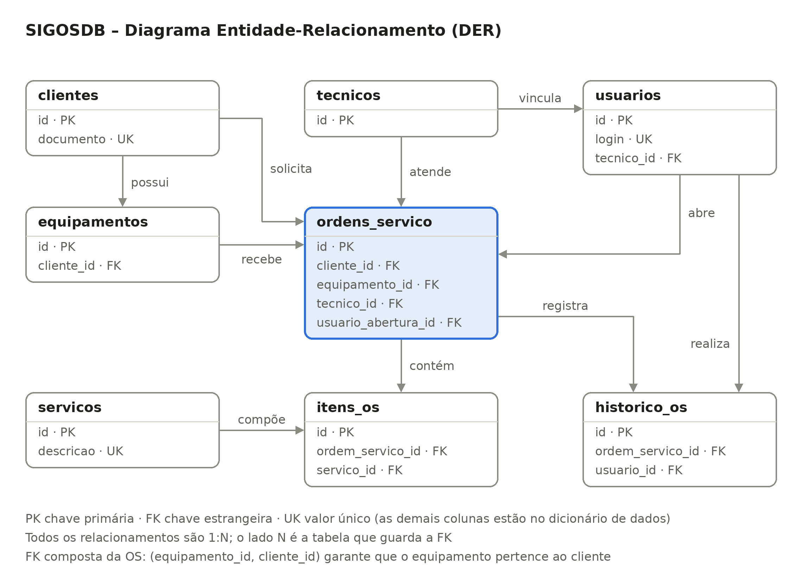

# SIGOS – Sistema Integrado de Gestão de Ordens de Serviço

Aplicação desktop em C# (Windows Forms) com banco MariaDB/MySQL que controla o ciclo de vida de uma ordem de serviço (OS) de assistência técnica: do cadastro do cliente e do equipamento até a conclusão ou o cancelamento, com histórico completo de cada mudança de status.

Projeto Integrador da disciplina de Programação C# Client/Server – Universidade Metodista de São Paulo (Análise e Desenvolvimento de Sistemas).

## Funcionalidades

- Login com perfis de acesso e menu que mostra só o que cada perfil pode usar
- Cadastro de clientes, equipamentos, técnicos e serviços
- Ordens de serviço: abertura, itens, desconto, fluxo de status e cancelamento com justificativa
- Histórico de cada OS (quem mudou o status, quando e por quê) e histórico por equipamento
- Consulta de OS com filtros por status, cliente, técnico e período
- Painel de indicadores: totais, OS pendentes, valor previsto e faturado, resumo por status e por técnico

## Perfis de acesso

| Perfil | O que pode acessar |
|---|---|
| ADMIN | Acesso total. É o único que aplica desconto nas OS |
| ATENDENTE | Clientes, equipamentos, relatórios, ordens de serviço e consultas. Abre OS. Não acessa técnicos nem serviços |
| TECNICO | Ordens de serviço e consultas. Não abre OS |

## Fluxo de status da OS

`ABERTA` → `DIAGNÓSTICO` → `AGUARDANDO APROVAÇÃO` → `EM EXECUÇÃO` → `CONCLUÍDA`

- O diagnóstico exige técnico atribuído
- Para enviar à aprovação, a OS precisa de diagnóstico e de pelo menos um serviço
- Para concluir, precisa de diagnóstico, serviço registrado e valor maior que zero
- Qualquer OS ainda aberta pode ser cancelada, mas exige justificativa
- OS concluída ou cancelada não muda mais, e não existe exclusão de OS

## Tecnologias

- C# com Windows Forms
- MariaDB/MySQL (via XAMPP) e phpMyAdmin
- MySql.Data (acesso ao banco)
- BCrypt.Net-Next (hash das senhas)

## Modelo de dados

O banco `sigosdb` tem 8 tabelas (`usuarios`, `tecnicos`, `clientes`, `equipamentos`, `servicos`, `ordens_servico`, `itens_os` e `historico_os`), 2 views e triggers que garantem as regras de negócio.

Regras garantidas pelo banco:

- Chave estrangeira composta `(equipamento_id, cliente_id)`: não é possível abrir uma OS com o equipamento de outro cliente
- Triggers para o fluxo de status, para bloquear itens em OS finalizada e para recalcular subtotal e total
- Restrições `CHECK` contra valores negativos e documento de cliente com 11 ou 14 dígitos
- Cliente e equipamento com vínculos não podem ser excluídos; técnico e serviço usados em OS são inativados

## Estrutura do repositório

| Pasta | Conteúdo |
|---|---|
| `SIGOS` | Código-fonte da aplicação (solução do Visual Studio) |
| `SIGOSDB` | Script do banco de dados (`sigosdb.sql`) |
| `Manual_Documentacao` | Manual de instalação e documentação do projeto |
| `Modelo_DER` | Diagrama entidade-relacionamento |

## Como instalar

Requisitos: Windows 10 ou 11, XAMPP, Visual Studio 2022 (para abrir o código) e o .NET usado pelo projeto.

1. Instale o XAMPP e inicie o **Apache** e o **MySQL** no painel de controle.
2. Acesse `http://localhost/phpmyadmin`, vá em **Importar** e selecione o arquivo `SIGOSDB/sigosdb.sql`. O banco, as tabelas, as views, os triggers e alguns dados de exemplo são criados.
3. Abra a solução `SIGOS.sln` no Visual Studio e aguarde a restauração dos pacotes NuGet.
4. Confira a conexão na classe `Conexao.cs` (pasta `BancoDB`). O padrão do XAMPP é servidor `localhost`, porta `3306`, usuário `root` e senha vazia.
5. Pressione **F5** para executar.

O passo a passo completo, com solução de problemas, está no manual da pasta `Manual_Documentacao`.

## Primeiro acesso

Na primeira execução, o sistema cria o usuário administrador inicial:

- Usuário: `admin`
- Senha: `admin123`

O sistema não tem tela de cadastro de usuários. Para criar os usuários dos outros perfis, abra o `Program.cs`, remova o `//` das duas linhas `usuarios.Inserir(...)`, execute o sistema uma única vez e volte a comentá-las. Serão criados `atendente` (perfil ATENDENTE) e `tecnico` (perfil TECNICO), ambos com a senha `123456`.

## Testes

Foram executados 35 testes de integridade, em 8 grupos: fluxo da OS, cancelamento, integridade referencial, validações de entrada, login e permissões, transações, consultas e relatórios, e instalação do zero. Todos passaram.

## Autores

- Tiago Pereira da Silva
- Bruna Vieira Lansana
- Guilherme da Silva Costa Francisco
